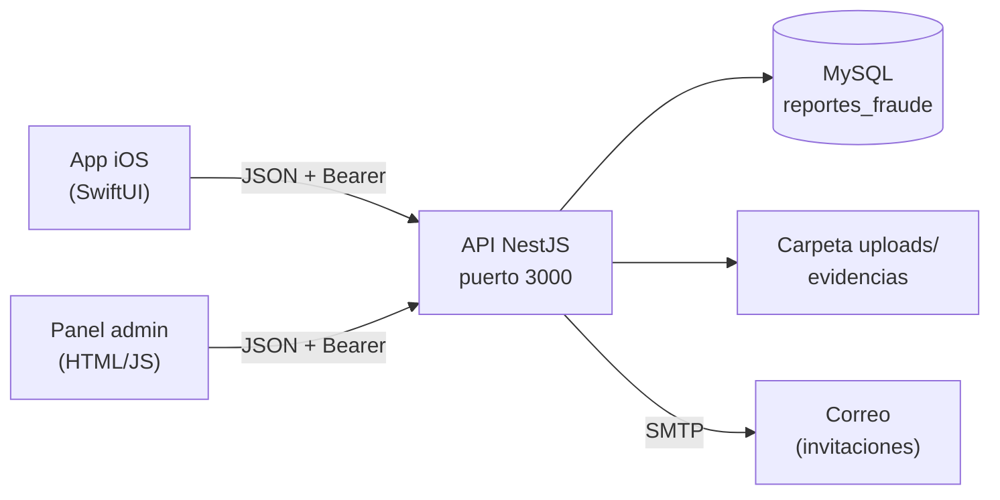
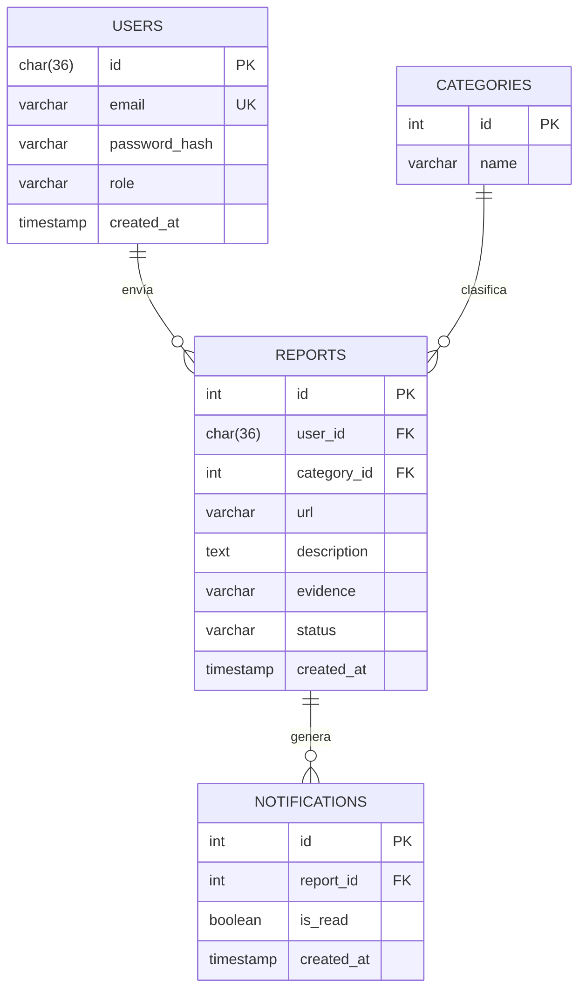
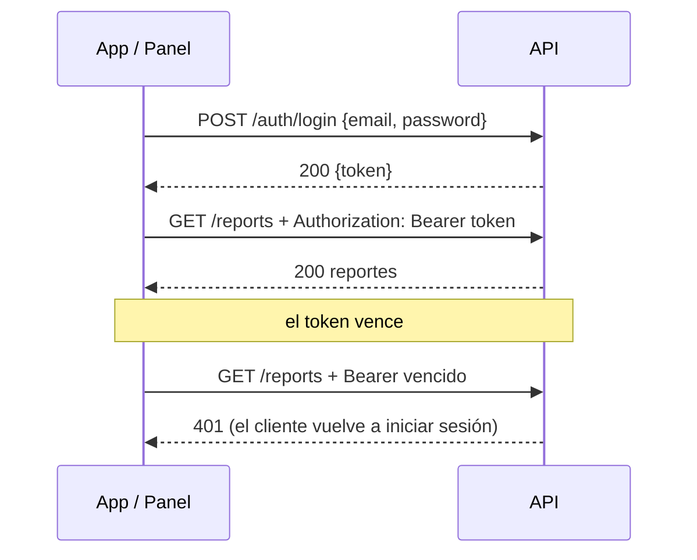

# NetShield — Backend (API)

**Versión:** [1.0] · **Fecha:** 2026-10-21 · **Equipo:** Flor Blacina Rodríguez Hernández, Ximena Itzel Camacho Flore, José Leonardo Salinas Ramirez, Randy Angelo Rosas Tolentino


## 1. Resumen

API REST de NetShield, el sistema para reportar y combatir sitios de phishing. Recibe los reportes que los usuarios envían desde la app iOS, los guarda en MySQL y los expone al panel web del administrador, que los revisa, clasifica y confirma. Maneja registro e inicio de sesión (usuarios y administradores), reportes con evidencia en imagen, categorías, notificaciones, invitaciones y estadísticas. Está construida con NestJS y se ejecuta dentro de la red propia del proyecto (sin depender de internet).

## 2. Arquitectura



- **API** (`backend/`): NestJS. Controllers, servicios, repositorios, validación con DTOs, guards de JWT y límite de peticiones.
- **Base de datos**: MySQL, base `reportes_fraude`, en un equipo distinto al de la API.
- **Archivos**: las evidencias se guardan en disco (`uploads/`) con multer.
- **Documentación interactiva**: Swagger en `/docs`.

### Despliegue en la red del proyecto

| Equipo | IP | Subred / VLAN | Puerto |
|---|---|---|---|
| Base de datos | 192.168.20.66 | VLAN 10 (192.168.20.64/28) | 3306 |
| API (este proyecto) | **[192.168.20.36]** | VLAN 20 (192.168.20.32/28) | 3000 |
| Panel admin | [192.168.20.82] | VLAN 30 (192.168.20.80/28) | [80/3001] |
| App iOS | DHCP | VLAN 40 (192.168.20.0/27), WiFi `NetShield-Clientes` | — |

El router solo permite que la subred 192.168.20.32/28 llegue a la base por el puerto 3306 (ACL `WEB-TO-DB`), por eso la API debe tener una IP dentro de ese rango.

## 3. Tecnologías y versiones

| Capa | Tecnología | Versión | Para qué |
|---|---|---|---|
| Lenguaje | TypeScript | [5.x] | toda la API |
| Runtime | Node.js | [20.x] | ejecutar la API |
| Framework | NestJS | [11.x] | módulos, controllers, guards |
| Base de datos | MySQL | [8.x] | persistencia |
| Driver | mysql2 | [3.x] | consultas SQL |
| Autenticación | JWT (@nestjs/jwt) | [x] | sesiones |
| Límite de peticiones | @nestjs/throttler | [x] | 60 peticiones por minuto |
| Archivos | multer | [x] | subida de evidencias |
| Correo | nodemailer | [x] | envío de invitaciones |
| Documentación | @nestjs/swagger | [x] | OpenAPI en `/docs` |

## 4. Instalación y ejecución

### 4.1 Requisitos
- Node.js [20] o superior
- Acceso de red a MySQL [8] (local o en otro equipo, puerto 3306)

### 4.2 Base de datos
En el equipo de la base:

```bash
mysql -u root -p -e "CREATE DATABASE IF NOT EXISTS reportes_fraude;"
mysql -u root -p reportes_fraude < [db/schema.sql]
```

Crear el usuario de la API (cambiar la clave y el host según el entorno):

```sql
CREATE USER 'netshield'@'192.168.20.36' IDENTIFIED BY '<clave>';
GRANT ALL ON reportes_fraude.* TO 'netshield'@'192.168.20.36';
FLUSH PRIVILEGES;
```

Para aceptar conexiones desde otro equipo, MySQL debe escuchar en red (`bind-address = 0.0.0.0` en `my.ini`/`mysqld.cnf`) y el firewall debe abrir el puerto 3306.

### 4.3 API

```bash
cd backend
npm install
cp .env.example .env     # y llenar los valores
npm run start:dev        # http://localhost:3000, Swagger en /docs
```

La API escucha en `0.0.0.0:3000`, así que otros equipos de la red pueden alcanzarla. Al arrancar imprime sus direcciones locales y de red.

### 4.4 Variables de entorno (`.env`)

| Variable | Ejemplo | Para qué |
|---|---|---|
| `DATABASE_URL` | `mysql://netshield:<clave>@192.168.20.66:3306/reportes_fraude` | conexión a MySQL |
| `JWT_SECRET` | `[cadena larga aleatoria]` | firmar los tokens |
| `ADMIN_BOOTSTRAP_CODE` | `[código secreto]` | permite crear la cuenta de administrador |
| `SMTP_HOST` | `smtp.[proveedor].com` | servidor de correo |
| `SMTP_PORT` | `587` | puerto SMTP |
| `SMTP_USER` / `SMTP_PASS` | `[usuario]` / `[clave]` | autenticación SMTP |
| `MAIL_FROM` | `NetShield <[correo]>` | remitente de los correos |

> **Importante:** en `src/database/database.module.ts` la `DATABASE_URL` está escrita directamente en el código. Debe cambiarse a `process.env.DATABASE_URL` para que el `.env` surta efecto (ver riesgo 1 en la sección 8.2).

## 5. Modelo de datos



> **[Ajustar tablas y columnas al esquema real (`db/schema.sql`). Agregar también `invitations`.]**

- `status` del reporte: **[pendiente / confirmado / rechazado]**.
- `password_hash` guarda el hash de la contraseña, nunca la contraseña.
- `evidence` es el nombre del archivo guardado en `uploads/`.
- Al llegar un reporte nuevo se crea una notificación para el administrador.

## 6. API

Documentación completa e interactiva en **`http://<IP-de-la-API>:3000/docs`**. Resumen **[ajustar a las rutas reales]**:

| Método | Ruta | Auth | Qué hace |
|---|---|---|---|
| POST | `/auth/register` | no | registra un usuario de la app |
| POST | `/auth/login` | no | inicia sesión y regresa el token |
| POST | `/admin/auth/register` | código de admin | crea un administrador |
| POST | `/admin/auth/login` | no | inicia sesión de administrador |
| GET | `/reports` | Bearer | lista reportes |
| POST | `/reports` | Bearer | crea un reporte (con evidencia opcional) |
| GET | `/reports/:id` | Bearer | detalle de un reporte |
| PATCH | `/reports/:id` | admin | confirma o rechaza |
| DELETE | `/reports/:id` | Bearer | elimina |
| GET | `/users` | admin | lista usuarios |
| GET / POST | `/categories` | Bearer / admin | consulta y crea categorías |
| GET | `/notifications` | admin | lista notificaciones |
| PATCH | `/notifications/:id/read` | admin | marca como leída |
| GET / POST | `/invitations` | admin | lista y crea invitaciones |
| GET | `/stats` | admin | totales y gráficas |

Errores: `{ statusCode, message, error }`. `message` puede ser un arreglo cuando falla la validación del DTO.

## 7. Autenticación



- Tokens JWT firmados con `JWT_SECRET`.
- Los administradores se crean solo con el `ADMIN_BOOTSTRAP_CODE` **[o por invitación]**.
- Límite global: 60 peticiones por minuto por cliente (`ThrottlerModule`, ttl 60000, limit 60).

## 8. Seguridad

### 8.1 Decisiones tomadas

| Tema | Decisión | Por qué |
|---|---|---|
| Contraseñas | se guardan con hash **[bcrypt, N rondas]** | si se filtra la base, no se filtran contraseñas |
| Sesión | JWT con vencimiento **[tiempo]** | un token robado sirve poco tiempo |
| Autorización | guards por rol (usuario / administrador) | el cliente no decide quién ve qué |
| Fuerza bruta | `ThrottlerModule` (60/min) | frena intentos repetidos |
| Validación | DTOs con class-validator **[y whitelist]** | lo que no está en el DTO no entra |
| Archivos | solo imágenes, tamaño máximo **[2 MB]**, nombre generado por el servidor | evitar subir scripts y recorrer rutas |
| Red | ACL: solo 192.168.20.32/28 llega a MySQL por 3306 | aislar la base de datos |
| Secretos | `.env` fuera del repositorio | no publicar llaves |

### 8.2 Riesgos conocidos

| # | Riesgo | Dónde | Impacto | Qué haría falta |
|---|---|---|---|---|
| 1 | Credenciales de MySQL escritas en el código (`DATABASE_URL`), incluida una contraseña de `root` | `src/database/database.module.ts` | quien vea el repositorio obtiene acceso a la base | leer de `.env`, rotar la contraseña y no usar `root` |
| 2 | CORS abierto a cualquier origen **[confirmar]** | `main.ts` | otro sitio puede llamar a la API | lista de orígenes permitidos |
| 3 | Tráfico en HTTP sin cifrar dentro de la LAN | API ↔ clientes | alguien en la red puede leer el tráfico | HTTPS con certificado |
| 4 | Usuario de MySQL con permiso `ALL` y host `%` **[si se usó]** | MySQL | más privilegio del necesario | solo `SELECT, INSERT, UPDATE, DELETE` y host de la API |
| 5 | Cerrar sesión no invalida el token en el servidor **[confirmar]** | API | un token copiado sirve hasta vencer | lista de revocados |
| 6 | **[Agregar hallazgos de OWASP ZAP / Nessus]** | | | |

## 9. Estructura de carpetas

```
backend/
├── src/
│   ├── admin/          # login y registro de administradores
│   ├── auth/           # registro, login, correo, repositorio de usuarios
│   ├── reports/        # reportes y evidencias
│   ├── users/          # usuarios
│   ├── database/       # conexión a MySQL
│   ├── app.controller.ts
│   └── main.ts         # puerto 3000, Swagger, CORS
├── [db/schema.sql]
├── uploads/
└── .env
```

## 10. Pruebas

```bash
npm run test        # pruebas unitarias
npm run test:e2e    # pruebas de extremo a extremo
```

**[Resumen de resultados y pruebas de seguridad realizadas: OWASP ZAP, Nessus, Xcode (app), GitHub (revisión de código).]**

## 11. Solución de problemas

| Mensaje | Causa | Solución |
|---|---|---|
| `Access denied for user 'root'@'localhost'` | la API usa la URL escrita en el código | cambiar `DATABASE_URL` y reiniciar |
| `Host '<ip>' is not allowed to connect` (1130) | el usuario de MySQL no existe para esa IP | `CREATE USER 'netshield'@'<ip>'` y `GRANT` |
| `ECONNREFUSED` | MySQL no escucha en red | `bind-address = 0.0.0.0` |
| `ETIMEDOUT` | firewall o ACL bloquean el 3306 | abrir el puerto; revisar subred de la API |
| `Unknown database` / `Table doesn't exist` | falta crear o importar el esquema | ejecutar `schema.sql` |
| La app dice "no se pudo conectar" | IP o puerto incorrectos, o firewall en el 3000 | revisar la IP de la API y abrir el puerto 3000 |

## 12. Pendientes y mejoras

- [ ] Pasar todas las credenciales a variables de entorno
- [ ] HTTPS dentro de la LAN
- [ ] Revocación de tokens al cerrar sesión
- [ ] Restringir CORS y privilegios de MySQL
- [ ] **[Agregar los pendientes del equipo]**
